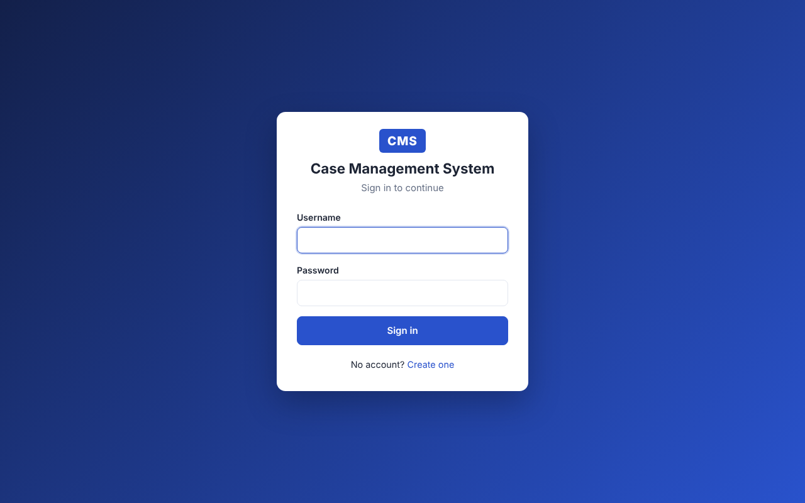
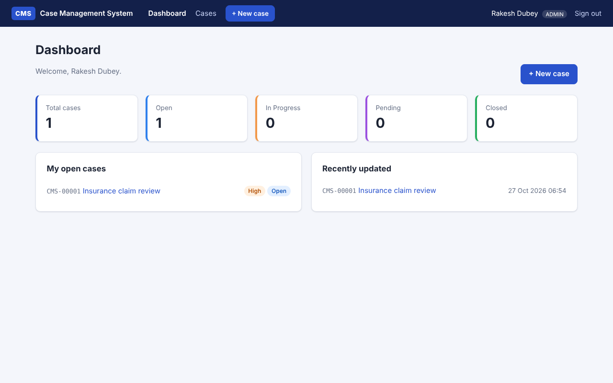
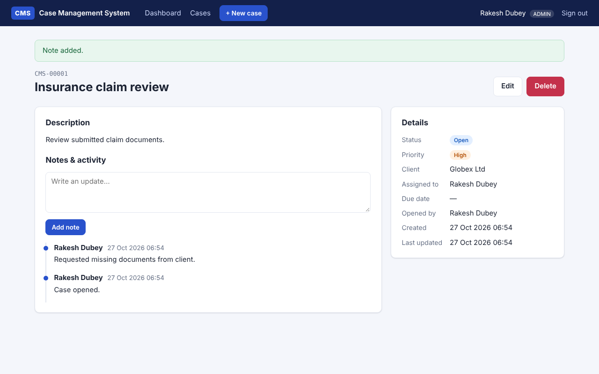

# Case Management System (CMS)

A web portal where users sign in to open, track and work on cases.
It's built with Flask and SQLite.



## Features

- **Sign-in:** register, log in and log out. Passwords are stored hashed, and every form has CSRF protection.
- **Roles:** the first account you register becomes the **admin**. Every later account is an **agent**. Only admins can delete cases.
- **Dashboard:** case counts by status, your open cases and recently updated cases.
- **Cases:** create, view and edit cases. Each case has a case number (`CMS-00001`), title, client, description, status, priority, assignee and due date.
- **Search and filters:** search by text, filter by status or priority, or show only cases assigned to you.
- **Notes and activity:** each case has a timeline of notes. Changes to status, priority and assignee are logged automatically.

## Quick start

**Windows:** double-click `start.bat`. **macOS/Linux:** run `./start.sh`.
The first run sets everything up. When the window shows *"CMS is running"*,
open http://127.0.0.1:5000. Keep that window open while you use the app,
because closing it stops the server.

### Manual setup

```bash
python3 -m venv .venv
source .venv/bin/activate          # Windows: .venv\Scripts\activate
pip install -r requirements.txt

flask --app cms init-db            # creates instance/cms.sqlite
flask --app cms run --debug        # http://127.0.0.1:5000
```

Open http://127.0.0.1:5000, click **Create one** and register. The first account is the admin.

> `init-db` drops and recreates every table. Run it only once, or when you want a clean database.

### Configuration

| Variable          | Purpose                                     | Default         |
|-------------------|---------------------------------------------|-----------------|
| `CMS_SECRET_KEY`  | Session signing key (**set in production**) | `dev-change-me` |

## Tests

```bash
pip install -r requirements-dev.txt
pytest
```

## Project layout

```
cms/
  __init__.py      app factory, login manager, CSRF
  db.py            SQLite connection + `init-db` command
  schema.sql       tables: user, cases, case_note
  models.py        User model, statuses, priorities
  forms.py         WTForms forms
  auth.py          /auth/login, /auth/register, /auth/logout
  cases.py         /dashboard, /cases, case detail/edit/notes/delete
  templates/       Jinja templates
  static/style.css
tests/             pytest suite
```

## Screenshots

| Dashboard | Case detail |
|---|---|
|  |  |
